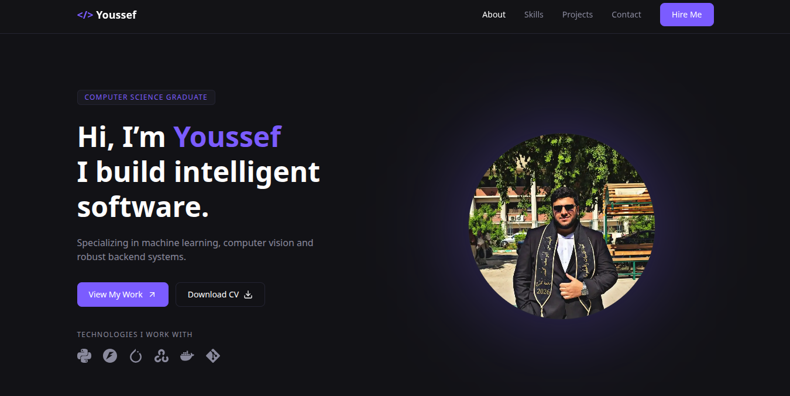

# Youssef Mohamed | Portfolio

Personal portfolio website for Youssef Mohamed, a Computer Science graduate specializing in AI and software engineering.

**Live:** https://youssef-portfolio-topaz.vercel.app



## Tech stack

- React + TypeScript (Vite)
- Tailwind CSS v4
- Lucide and React Icons

## Sections

About, Skills, Projects, Contact.

## Getting started

```bash
npm install
npm run dev
```

Other commands:

```bash
npm run build     # production build
npm run preview   # preview the production build
npm run lint      # lint the code
```

## Editing the content

All content lives in `src/data/`, so no component needs to change:

| File          | What it controls                                           |
| ------------- | ---------------------------------------------------------- |
| `about.ts`    | Name, headline, bio and highlight cards                    |
| `skills.ts`   | Skill groups (icons are mapped in `src/lib/skillIcons.ts`) |
| `projects.ts` | Project cards: title, description, tech, links, screenshot |
| `contact.ts`  | Contact links                                              |

To add a project screenshot, put a 1280×720 `.webp` file in `src/assets/images/projects/`, import it in `projects.ts` and set it as `image`.

To change the CV, replace `public/Youssef_CV.pdf` and keep the same file name.

## Colors

The theme is defined in `src/styles/global.css` under `@theme`. Changing a value there updates the whole site.

## Deployment

The site is deployed on Vercel. Every push to `main` triggers a new deployment.

- Build command: `npm run build`
- Output directory: `dist`
